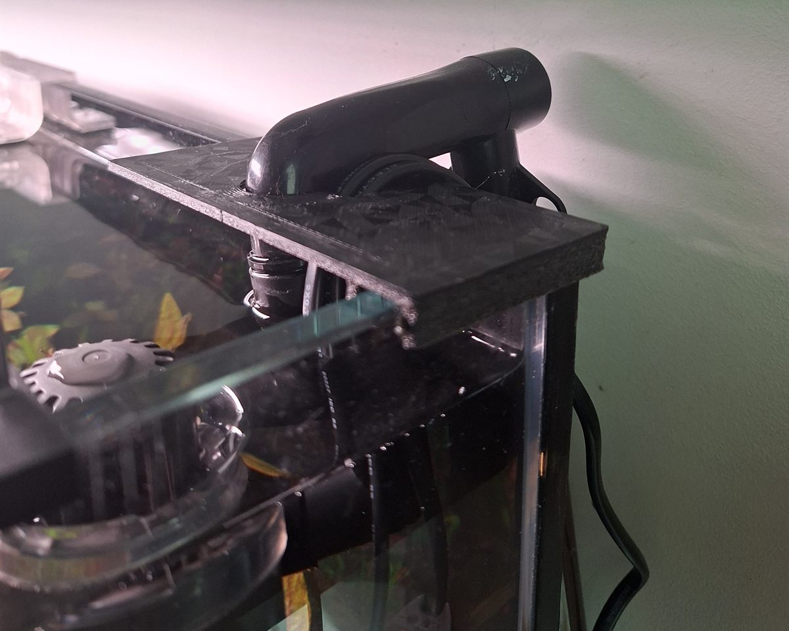
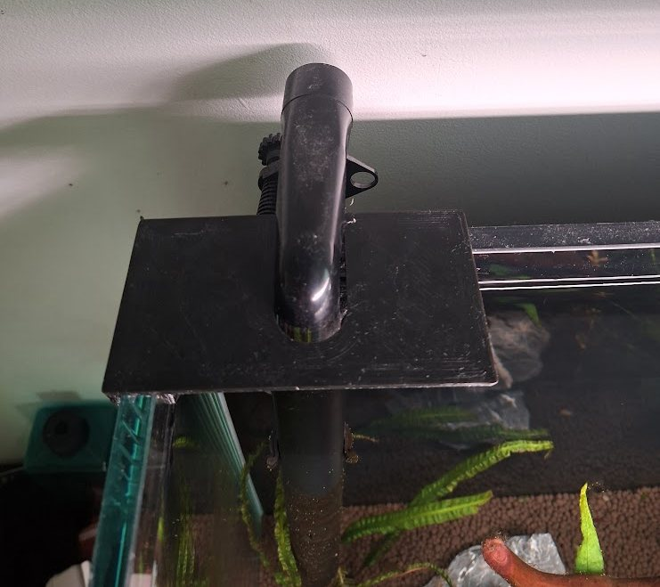
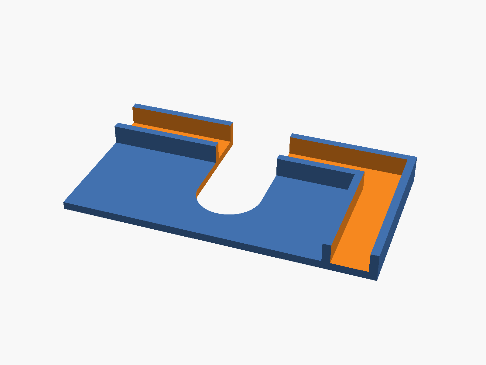
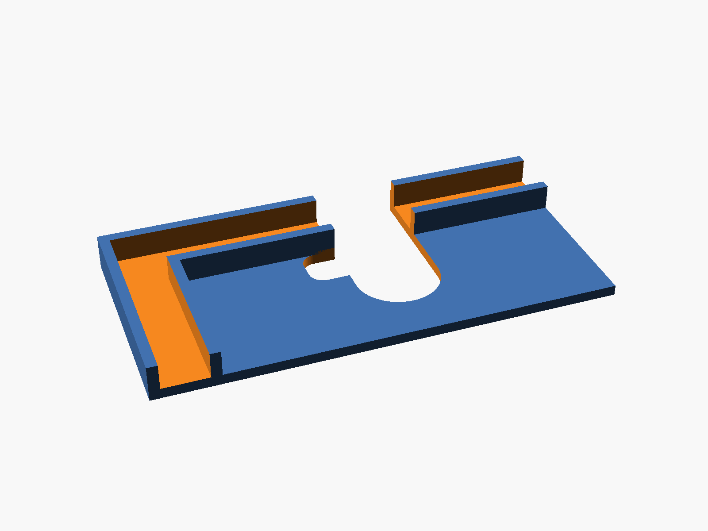
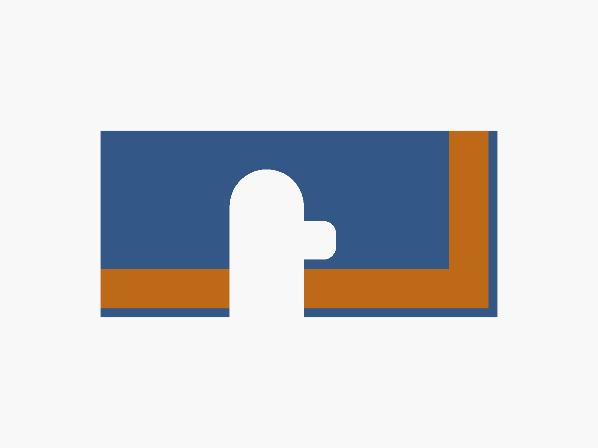
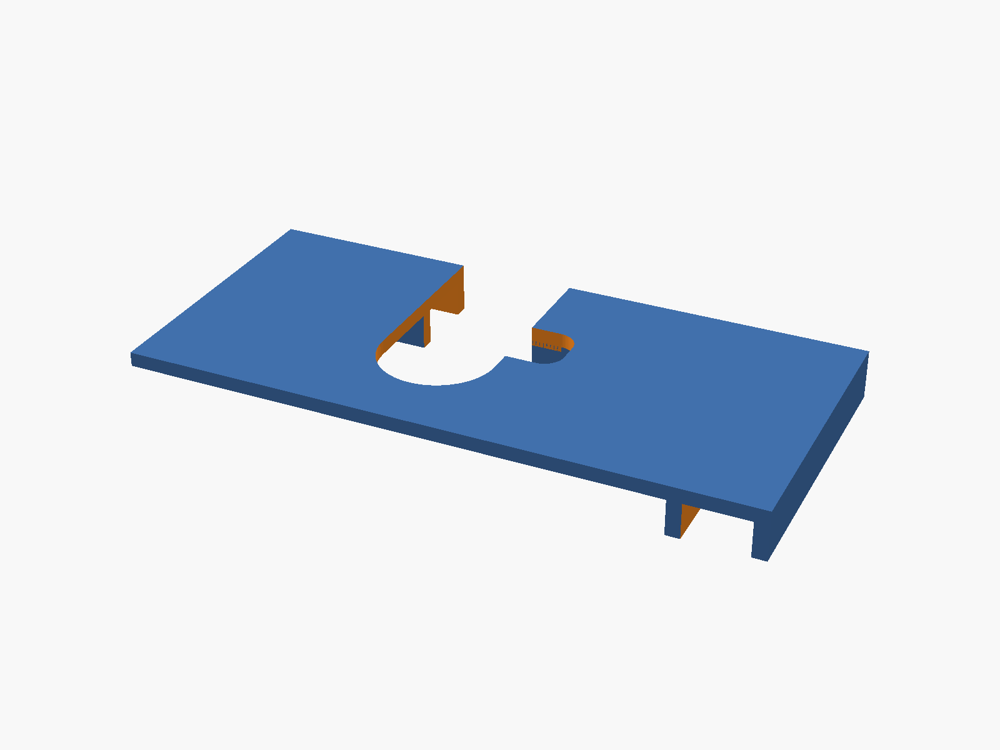

# Aquarium Shrimp Escape Guard

A pair of 3D-printable corner covers for the top rim of an aquarium that stop shrimp (for example Amano shrimp) from climbing out. Each guard clips onto the back glass and the side glass at a back corner, and a flat ledge reaches 40 mm into the tank along both glasses, so a shrimp climbing up the glass meets an overhang. A U-shaped cutout fits closely around the filter pipe where it comes over the glass, which is the usual escape route. The right guard, for the outlet pipe, also has an opening for the power cables of a heater and a skimmer.

The model is written in OpenSCAD and is fully parametric. All parameters and geometry are in one `.scad` file, and `left_guard.scad` / `right_guard.scad` open each guard on its own. The right guard is the mirror image of the left one, with its own dimensions.

Amano shrimp climb out along the filter pipes, the cables and the silicone seams in the corners, mostly at night. In this tank, all of these meet at the two back corners, so that is where the guards go. The rest of the water surface stays open, so gas exchange is not reduced as it would be with a full lid.

## 📷 Gallery

### In use

<p align="center">
  
  
</p>

* **Right guard:** clipped onto the back corner around the filter outlet pipe. The heater and skimmer cables go down through the cable opening next to the pipe.
* **Left guard:** seen from the front. The U cutout fits closely around the filter pipe, and the ledge covers the rim on both sides.

### Renders

<p align="center">
  
  
</p>

<p align="center">
  
  
</p>

* **Left guard:** as printed, with the top plate on the build plate and the L-shaped glass slot facing up. The U cutout for the intake pipe is in the back arm.
* **Right guard:** the mirror image, with the outlet pipe cutout 60 mm from the outer corner and the cable opening on the corner side of the pipe.
* **Top view:** the pipe cutout and the cable opening joined into one opening, with a rounded end on the corner side.
* **Mounted:** the right guard turned over, as it sits on the glass. The clip walls hang down over the glass and the ledge covers the rim from the inside.

## 🧩 Parts

| Part | File | STL | Size | Description |
|------|------|-----|------|-------------|
| **Left guard** | `left_guard.scad` | `left_guard.stl` | 108.9 × 57.9 × 9.8 mm | Back-left corner, around the filter intake pipe. |
| **Right guard** | `right_guard.scad` | `right_guard.stl` | 123 × 57.9 × 9.8 mm | Back-right corner, around the filter outlet pipe, with an opening for two power cables. |

`left_guard.scad` and `right_guard.scad` only call the guard modules. The parameters and geometry of both guards are in `aquarium-shrimp-escape-guard.scad`, where `part` (`left`, `right` or `both`) chooses what to render.

## 📏 Default Dimensions

With the default parameters, the guards have the following specifications:

**Both guards**
* **Glass slot:** 12.3 mm (10 mm glass + 2.3 mm clearance), continuous L shape with no wall in the corner
* **Clip:** 17.9 mm wide, 2.8 mm walls, reaching 7 mm down over the glass
* **Top plate:** 2.8 mm thick
* **Ledge:** 40 mm into the tank from the inner clip wall, along both arms
* **Side arm:** 40 mm along the side glass, measured from the back clip
* **Pipe cutout:** 23 mm wide, reaching 28 mm into the tank, with a rounded end; a 10 mm strap forms the U around it. Both clip walls are removed where the pipe passes over the glass.
* **Back arm past the pipe:** 40 mm

**Left guard**
* **Outer corner to pipe cutout:** 45.9 mm

**Right guard**
* **Outer corner to pipe cutout:** 60 mm
* **Cable opening:** 8 mm along the glass × 12 mm into the tank, against the inner clip wall, on the corner side of the pipe, joined to the pipe cutout. The corner-side end is rounded with R4 mm.

## ✨ Features

* **One File, Two Guards:** a single `.scad` file holds both guards. The right guard is the mirror image of the left one, but each has its own group of dimensions in the Customizer.
* **Fully Parametric:** the glass thickness and clearance, the clip, the ledge, the arm lengths, the pipe position and size, and the cable opening are all parameters.
* **Fixed Reference:** distances "from the corner" and "from the glass" are measured from the inner face of the clip. Changing the glass clearance makes the clip wider towards the outside and does not move the pipe cutout.
* **Open Corner:** the glass slot is one continuous L with no wall inside the corner, so both glass edges slide in together.
* **Cable Opening:** the right guard's cable opening is joined to the pipe cutout, which is open on the outside. Slide the cables in from the side, so you don't have to thread the plugs through a hole.
* **Support-Free Printing:** the guard prints with the top plate on the build plate and the clip walls standing up.
* **Console Report and Input Checks:** the console prints the size of each guard and the distance from the outer corner to the pipe. The script stops with a clear message if the cable opening doesn't fit.

## 🚀 Usage

1. Install [OpenSCAD](https://openscad.org/) (tested with 2021.01).
2. Open `aquarium-shrimp-escape-guard.scad`.
3. Measure your aquarium and set the parameters (see the table below):
   * the glass thickness,
   * for each corner, the distance to the pipe, the width of the pipe and how far it reaches into the tank.
4. Set `part` to `left`, `right` or `both` and press **F5** to preview. Check the console report.
5. Render the model (**F6**) and export an STL (**F7**). You can also open `left_guard.scad` or `right_guard.scad` to render and export one guard on its own.

Ready-made STLs for the default dimensions are in the [`stl/`](stl/) folder.

### Key parameters

| Parameter | Default | Description |
|-----------|---------|-------------|
| `part` | `"both"` | `"left"`, `"right"` or `"both"` (both guards side by side on one build plate) |
| `glass_thickness` | `10` | Thickness of the aquarium glass |
| `glass_clearance` | `2.3` | Extra slot width for an easy fit and for print tolerance |
| `wall_thickness` | `2.8` | Clip walls and top plate |
| `clip_height` | `7` | How far the clip walls reach down over the glass |
| `ledge_width` | `40` | How far the ledge reaches into the tank |
| `loop_width` | `10` | Width of the strap around the pipe |
| `*_side_arm_length` | `40` | Arm along the side glass, from the back clip |
| `*_pipe_offset` | `28` / `42.1` | Corner to the pipe cutout, from the side clip (left / right) |
| `*_length_after_pipe` | `40` | Back arm past the pipe cutout |
| `*_pipe_width` | `23` | Width of the pipe cutout along the glass |
| `*_pipe_protrusion` | `28` | How far the pipe elbow reaches into the tank |

`*` = `left_` or `right_`.

### Cable opening (right guard)

| Parameter | Default | Description |
|-----------|---------|-------------|
| `right_cable_hole` | `true` | `false` removes the cable opening |
| `right_cable_side` | `"before"` | `"before"` = between the corner and the pipe, `"after"` = past the pipe |
| `right_cable_width` / `right_cable_depth` | `8` / `12` | Size of the opening along the glass / into the tank |
| `right_cable_gap` | `2` | Distance from the opening to the pipe cutout |
| `right_cable_offset` | `0` | Distance from the inner clip wall (`0` = touching) |
| `right_cable_merge` | `true` | Join the opening to the pipe cutout. `false` leaves a closed oval hole with a bridge to the pipe. |

## 📁 Project Structure

```
aquarium-shrimp-escape-guard/
├── aquarium-shrimp-escape-guard.scad   # Parameters and geometry of both guards
├── left_guard.scad                     # Opens the left guard on its own
├── right_guard.scad                    # Opens the right guard on its own
├── stl/                                # Ready-to-print STLs (default dimensions)
│   ├── left_guard.stl
│   └── right_guard.stl
├── images/                             # OpenSCAD renders and photos
├── LICENSE                             # CC BY-NC-SA 4.0
└── README.md
```

## 🖨️ Recommended Print Settings

* **Material:** PETG. It holds up well to water and humidity. Use plain filament without additives, because the ledge sits right above the water.
* **Orientation:** top plate on the build plate, clip walls facing up (as exported). No supports.
* **Layer height:** 0.2 mm.
* **Walls:** 3–4 perimeters. The clip walls are only 2.8 mm thick, so they end up almost solid.
* **Infill:** 20–30%. The top plate is thin and mostly made of top and bottom layers.
* **First layer:** watch out for elephant's foot. The top plate is a large flat area, and a flared first layer makes the pipe and cable openings smaller.

## ⚠️ Fit & Tolerances

* **Glass slot:** the first print used a 0.3 mm clearance and did not fit the glass because of print imperfections. The default is now 2.3 mm (12.3 mm slot for 10 mm glass). If the guard is loose, lower `glass_clearance`. If it doesn't slide on, raise it.
* **Pipe position:** `*_pipe_offset` is measured from the inner face of the clip. If you change `glass_clearance`, the distance from the outer corner to the pipe changes by the same amount. The right guard's 60 mm needs `right_pipe_offset = 60 - clip_width` (the console prints both values).
* **Pipe cutout:** `*_pipe_width = 23` is the width of the pipe plus its side holder. Measure your filter pipe. A cutout that is too wide leaves a gap that shrimp can climb through.
* **Cables:** the 8 × 12 mm opening holds two round cables of about Ø6 mm, one behind the other. For thicker or flat cables, increase `right_cable_width`. Round cables leave small gaps in the corners of the opening, and a young shrimp climbing up a cable can get through them. Plug the gaps with a piece of filter sponge.
* **Limits:** the guards cover only the two back corners. The front corners and the long edges stay open. If shrimp keep trying to climb out, check the water first (ammonia, nitrite, sudden changes in temperature or hardness, slow acclimation of new shrimp). The guards keep them in the tank, but they don't fix the reason they want to leave.

## 📝 Changelog

**v1.1**
* Right guard for the filter outlet pipe (mirror image of the left guard, with its own dimensions), 60 mm from the outer corner to the pipe
* Cable opening for the heater and skimmer cables in the right guard, joined to the pipe cutout
* Glass clearance raised from 0.3 mm to 2.3 mm
* Code refactored: English names and comments, Customizer groups, named module arguments, `assert()` input checks, console report. With the same parameters, the shape is unchanged (checked with a boolean difference in both directions).
* `left_guard.scad` and `right_guard.scad` to open each guard on its own
* STLs in `stl/`, renders in `images/`
* CC BY-NC-SA 4.0 license

**v1.0** – First printed version: a single corner guard with an L-shaped glass slot, a ledge along both arms and a U cutout for the filter pipe.

---
*This project is source-available under the [Creative Commons Attribution-NonCommercial-ShareAlike 4.0 International](LICENSE) license (CC BY-NC-SA 4.0). You are free to share and adapt it for non-commercial purposes, as long as you give credit and release your changes under the same license. If you wish to use this project for commercial purposes, please contact me. Developed and designed by Maciej Ślubowski.*
